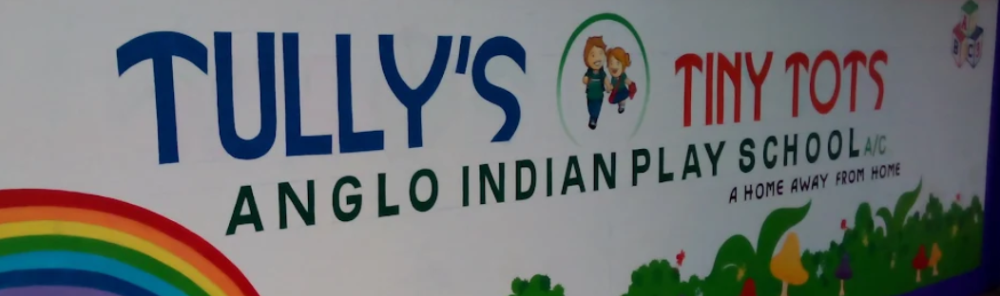

<Frame>
  
</Frame>

  <h1 style={{ fontSize: "2.5rem", fontWeight: 800, margin: 0 }}>
    Tully's{" "}
    Tiny Tots
  </h1>

  

    ANGLO INDIAN PLAY SCHOOL
  

  

    A home away from home
  

## Welcome

Welcome to Tully's Tiny Tots, an Anglo Indian play school where little ones learn, play and grow in a warm, caring space that feels just like home.

<CardGroup cols={3}>
  <Card title="A home away from home" icon="house-heart">
    A friendly, family-like setting where every child feels safe and welcome.
  </Card>

  <Card title="Anglo Indian play school" icon="children">
    Early learning rooted in play, for our tiniest learners.
  </Card>

  <Card title="Air-conditioned" icon="snowflake">
    Cool, comfortable classrooms all year round.
  </Card>
</CardGroup>

## Core Learning Domains

A well-rounded preschool curriculum focuses on multiple areas of development:

<CardGroup cols={2}>
  <Card title="Academic Foundations" icon="book-open">
    Early literacy (letter recognition, phonics, storytelling) and basic numeracy (counting, shapes, sorting, patterns).
  </Card>

  <Card title="Social-Emotional Development" icon="heart">
    Sharing, turn-taking, peer interaction, emotional awareness, and self-regulation.
  </Card>

  <Card title="Physical Development" icon="person-running">
    Gross motor skills (running, balancing, jumping) and fine motor skills (cutting, drawing, using manipulatives).
  </Card>

  <Card title="Creative Expression" icon="palette">
    Arts, crafts, music, movement, and dramatic play.
  </Card>

  <Card title={"Life Skills & Independence"} icon="hands-bubbles">
    Self-help routines, personal hygiene, and decision-making.
  </Card>

  <Card title="General Awareness" icon="leaf">
    Nature, science exploration, weather, and cultural values.
  </Card>
</CardGroup>

## Frameworks & Guidelines

<CardGroup cols={2}>
  <Card title="National Standards" icon="landmark">
    In India, early childhood education follows the National Curriculum Framework for the Foundational Stage and guidelines from the NCERT under the NEP 2020 vision.
  </Card>

  <Card title="Curricular Resources" icon="map">
    Structured programs like The Creative Curriculum or the Kangaroo Kids iCan Learning System offer thematic and future-skill-based roadmaps.
  </Card>
</CardGroup>

## Popular Preschool Pedagogical Approaches

Different preschools and homeschoolers use distinct philosophies:

<AccordionGroup>
  <Accordion title="Play-Based / Playway" icon="puzzle-piece">
    Centers learning around guided play, curiosity, and active exploration.
  </Accordion>

  <Accordion title="Montessori" icon="cubes">
    A child-centered, self-directed model using specialized hands-on materials in mixed-age classrooms.
  </Accordion>

  <Accordion title="Reggio Emilia" icon="paintbrush">
    A project-based, collaborative approach where topics emerge from children's natural interests.
  </Accordion>

  <Accordion title="Waldorf" icon="tree">
    Focuses on creative play, oral storytelling, nature, and artistic or practical activities rather than early academics.
  </Accordion>

  <Accordion title="HighScope" icon="list-check">
    Uses active participatory learning with a consistent daily routine of planning, doing, and reviewing.
  </Accordion>
</AccordionGroup>

  

    Tully's{" "}
    Tiny Tots
  

  

    ANGLO INDIAN PLAY SCHOOL
  

  

    A home away from home
  

  

    © 2026 Tully's Tiny Tots. All rights reserved.
  

