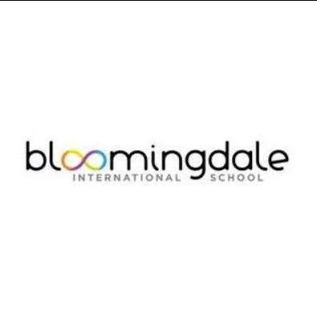

  

## Teaching Methodology & Curriculum

The preschool implements an inquiry-based, transdisciplinary curriculum modeled after the IB Primary Years Programme (PYP).

| Age Group / Class | Focus & Approach |
| --- | --- |
| Playgroup (Age 2) | Informal, highly interactive, play-based learning. |
| Nursery (Ages 3-4) | Introduction to a multiple-intelligences framework, guiding a smooth transition into structured routines. |
| Early Years (Ages 4-6) | Thematic lessons connecting core learning areas directly to the global IB framework. |

## The Campus & Environmental Norms (The Cocoon)

Bloomingdale's pre-primary wing is architectural famous for its fluid, fluidic "Cocoon" design.

<CardGroup cols={2}>
  <Card title="No Rigid Walls" icon="border-none">
    Traditional box-like classrooms are replaced with fluid, interconnected spaces partitioned by full-height glass panels and skylights. This design completely eliminates the harsh barrier between the indoors and outdoors, treating nature as an extension of the classroom.
  </Card>

  <Card title="Multipurpose Courtyard" icon="sun">
    The central courtyard morphs seamlessly to serve as a playground, an amphitheater, an open-air classroom, or a puddle pool depending on the day's activities.
  </Card>
</CardGroup>

## Core Pillars of Learning

<CardGroup cols={2}>
  <Card title="Continuous Assessment" icon="chart-line">
    The school avoids high-stress exams for young children. Progress is mapped through interactive quizzes, collaboration metrics, classroom effort, and hands-on projects.
  </Card>

  <Card title="Interactive Play" icon="music">
    Subjects are taught through physical interaction, creative arts (like pottery), music, dance, and storytelling rather than static textbooks.
  </Card>

  <Card title='The "Bridge Programme"' icon="bridge">
    Every academic year kicks off with a specialized framework where teachers assess each child's specific strengths to map out personalized mentorship.
  </Card>

  <Card title="Mind, Body, and Soul Development" icon="spa">
    Lessons balance basic curiosity and discovery with emotional wellbeing, physical motor skills, and self-directed independence.
  </Card>
</CardGroup>
